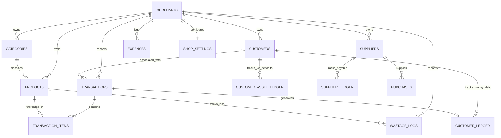

# SajiloPasal: Database Schema Specification

This document provides the complete, fully reconciled type-safe database schema for **SajiloPasal**, defining both the local **Dexie.js (IndexedDB)** store definitions and the cloud **Supabase (PostgreSQL)** relational tables.

---

## 1. Relational Entity Relationship Diagram (ERD)



---

## 2. Table Definitions & Data Types

### 2.1 `shop_settings`
| Column | Type | Constraints | Description |
| :--- | :--- | :--- | :--- |
| `id` | `TEXT` | PRIMARY KEY | Unique settings ID |
| `merchant_id` | `TEXT` | UNIQUE, NOT NULL | Merchant user ID |
| `pasal_name` | `TEXT` | NOT NULL | Shop name (e.g. Shrestha Kirana) |
| `owner_name` | `TEXT` | NOT NULL | Owner full name |
| `phone` | `TEXT` | NOT NULL | Contact phone number |
| `address` | `TEXT` | NULL | Tole, City, District |
| `pan_number` | `TEXT` | NULL | 9-Digit PAN number |
| `qr_image_url` | `TEXT` | NULL | Base64/Storage URL for Fonepay/eSewa QR |
| `fonepay_link` | `TEXT` | NULL | Remote payment link |
| `receipt_header`| `TEXT` | NULL | Custom bill header note |
| `receipt_footer`| `TEXT` | NULL | Custom greeting (e.g. धन्यवाद, फेरी आउनुहोला!) |
| `paper_width` | `TEXT` | DEFAULT '58mm' | `58mm` or `80mm` |
| `sound_enabled` | `BOOLEAN`| DEFAULT true | Soundbox audio chime toggle |
| `haptics_enabled`| `BOOLEAN`| DEFAULT true | Device vibration toggle |
| `default_date_mode`| `TEXT` | DEFAULT 'BS' | `BS`, `AD`, `DUAL` |
| `default_language`| `TEXT` | DEFAULT 'ne' | `ne` (नेपाली) or `en` (English) |
| `owner_pin_hash`| `TEXT` | NULL | Bcrypt/SHA hash for 4-digit Staff Lock PIN |
| `theme_preset` | `TEXT` | DEFAULT 'ios-classic'| Theme key |
| `custom_accent_hsl`| `TEXT`| NULL | Custom HSL accent string |
| `updated_at` | `TEXT` | NOT NULL | Sync timestamp |

### 2.2 `categories`
| Column | Type | Constraints | Description |
| :--- | :--- | :--- | :--- |
| `id` | `TEXT` | PRIMARY KEY | UUID or nanoid |
| `merchant_id` | `TEXT` | NOT NULL, INDEXED | Merchant account ID |
| `name_en` | `TEXT` | NOT NULL | Category name in English (e.g. Noodles) |
| `name_np` | `TEXT` | NOT NULL | Category name in Nepali (e.g. चाउचाउ) |
| `icon` | `TEXT` | NULL | Lucide icon name or emoji |
| `sort_order` | `INTEGER` | DEFAULT 0 | Ordering index for quick-grid |
| `created_at` | `TEXT` | NOT NULL | ISO-8601 UTC timestamp |

### 2.3 `products`
| Column | Type | Constraints | Description |
| :--- | :--- | :--- | :--- |
| `id` | `TEXT` | PRIMARY KEY | Unique product ID |
| `merchant_id` | `TEXT` | NOT NULL, INDEXED | Owner merchant ID |
| `category_id` | `TEXT` | NULL, INDEXED | References categories(id) |
| `name` | `TEXT` | NOT NULL, INDEXED | Product name (e.g. Wai Wai 75g) |
| `barcode` | `TEXT` | NULL, INDEXED | Barcode number (UPC/EAN) |
| `selling_price` | `REAL` | NOT NULL | Retail selling price in NPR |
| `wholesale_price`| `REAL` | NULL | Wholesale bulk price in NPR |
| `cost_price` | `REAL` | DEFAULT 0.0 | Wholesale cost price in NPR |
| `stock_quantity`| `REAL` | DEFAULT 0.0 | Current stock on hand |
| `unit` | `TEXT` | DEFAULT 'piece' | `piece`, `packet`, `kg`, `gram`, `liter`, `bora`, `pau`, `dharni` |
| `is_quick_grid` | `BOOLEAN`| DEFAULT false | Pinned to POS quick-grid screen |
| `is_returnable_asset`| `BOOLEAN`| DEFAULT false | Jar/Cylinder returnable asset flag |
| `low_stock_threshold` | `REAL` | DEFAULT 5.0 | Alert threshold |
| `image_url` | `TEXT` | NULL | Product photo or preset icon |
| `updated_at` | `TEXT` | NOT NULL | Sync timestamp |

### 2.4 `customers`
| Column | Type | Constraints | Description |
| :--- | :--- | :--- | :--- |
| `id` | `TEXT` | PRIMARY KEY | Unique customer ID |
| `merchant_id` | `TEXT` | NOT NULL, INDEXED | Owner merchant ID |
| `name` | `TEXT` | NOT NULL, INDEXED | Customer full name |
| `phone` | `TEXT` | NULL, INDEXED | 10-digit mobile number |
| `address` | `TEXT` | NULL | Tole / Landmark |
| `credit_limit` | `REAL` | DEFAULT 5000.0 | Maximum allowed udharo balance |
| `current_balance`| `REAL` | DEFAULT 0.0 | Total money debt owed (NPR) |
| `credit_frozen` | `BOOLEAN`| DEFAULT false | Blocks new Udharo checkouts |
| `notes` | `TEXT` | NULL | Customer notes (e.g. "Temple house") |
| `last_payment_date`| `TEXT` | NULL | Timestamp of last settlement |
| `created_at` | `TEXT` | NOT NULL | Registration date |
| `updated_at` | `TEXT` | NOT NULL | Sync timestamp |

### 2.5 `customer_asset_ledger` (Returnable Jars / Cylinders / Bottles)
| Column | Type | Constraints | Description |
| :--- | :--- | :--- | :--- |
| `id` | `TEXT` | PRIMARY KEY | Asset ledger ID |
| `merchant_id` | `TEXT` | NOT NULL, INDEXED | Owner merchant ID |
| `customer_id` | `TEXT` | NOT NULL, INDEXED | References customers(id) |
| `product_id` | `TEXT` | NOT NULL, INDEXED | References products(id) |
| `type` | `TEXT` | NOT NULL | `issued` (customer took jar) \| `returned` (empty jar returned) |
| `quantity` | `INTEGER` | NOT NULL | Number of units (e.g. 2 Jars) |
| `date_bs` | `TEXT` | NOT NULL | Bikram Sambat timestamp |
| `created_at` | `TEXT` | NOT NULL | ISO-8601 timestamp |

### 2.6 `transactions` (POS Bills & Sales)
| Column | Type | Constraints | Description |
| :--- | :--- | :--- | :--- |
| `id` | `TEXT` | PRIMARY KEY | Unique receipt ID (e.g. BILL-2083-001) |
| `merchant_id` | `TEXT` | NOT NULL, INDEXED | Owner merchant ID |
| `customer_id` | `TEXT` | NULL, INDEXED | References customers(id) if udharo |
| `total_amount` | `REAL` | NOT NULL | Gross item total |
| `discount_amount`| `REAL` | DEFAULT 0.0 | Discount in NPR |
| `final_amount` | `REAL` | NOT NULL | Net amount payable |
| `cash_paid` | `REAL` | DEFAULT 0.0 | Cash / QR paid at checkout |
| `udharo_amount` | `REAL` | DEFAULT 0.0 | Debt added to customer khata |
| `pricing_tier` | `TEXT` | DEFAULT 'retail' | `retail` or `wholesale` |
| `payment_mode` | `TEXT` | NOT NULL | `full_cash`, `full_udharo`, `split`, `qr_online` |
| `is_pan_bill` | `BOOLEAN`| DEFAULT false | Formal PAN tax bill flag |
| `date_bs` | `TEXT` | NOT NULL | Nepali date string (e.g. 2083-05-04) |
| `created_at` | `TEXT` | NOT NULL, INDEXED | ISO-8601 UTC timestamp |

### 2.7 `transaction_items`
| Column | Type | Constraints | Description |
| :--- | :--- | :--- | :--- |
| `id` | `TEXT` | PRIMARY KEY | Item line ID |
| `transaction_id`| `TEXT` | NOT NULL, INDEXED | References transactions(id) |
| `product_id` | `TEXT` | NULL, INDEXED | References products(id) |
| `product_name` | `TEXT` | NOT NULL | Name snapshot at time of sale |
| `quantity` | `REAL` | NOT NULL | Sold qty (supports fractions, e.g. 0.5) |
| `unit` | `TEXT` | NOT NULL | Unit of sale |
| `unit_price` | `REAL` | NOT NULL | Unit rate in NPR |
| `total_price` | `REAL` | NOT NULL | Line subtotal (`qty * rate`) |

### 2.8 `customer_ledger` (Double-Entry Debt Tracker)
| Column | Type | Constraints | Description |
| :--- | :--- | :--- | :--- |
| `id` | `TEXT` | PRIMARY KEY | Ledger entry ID |
| `merchant_id` | `TEXT` | NOT NULL, INDEXED | Owner merchant ID |
| `customer_id` | `TEXT` | NOT NULL, INDEXED | References customers(id) |
| `transaction_id`| `TEXT` | NULL, INDEXED | Associated POS bill if debit |
| `type` | `TEXT` | NOT NULL | `debit` (goods taken on udharo) \| `credit` (payment received) |
| `amount` | `REAL` | NOT NULL | Transaction amount in NPR |
| `payment_method`| `TEXT` | DEFAULT 'cash' | `cash`, `fonepay_qr`, `esewa`, `bank` |
| `balance_after` | `REAL` | NOT NULL | Running total balance after entry |
| `notes` | `TEXT` | NULL | Entry notes (e.g. "500 via Fonepay") |
| `date_bs` | `TEXT` | NOT NULL | Bikram Sambat timestamp |
| `created_at` | `TEXT` | NOT NULL, INDEXED | ISO-8601 timestamp |

### 2.9 `suppliers` & `supplier_ledger`
* Tracks wholesaler company names, contact numbers, purchase logs, credit owed, and payments made.

### 2.10 `expenses`
* `id`, `merchant_id`, `category` (*tea, electricity, rent, transport, staff, maintenance*), `amount`, `payment_mode`, `notes`, `date_bs`, `created_at`.

### 2.11 `wastage_logs` (Damaged, Expired & Broken Goods)
| Column | Type | Constraints | Description |
| :--- | :--- | :--- | :--- |
| `id` | `TEXT` | PRIMARY KEY | Wastage log ID |
| `merchant_id` | `TEXT` | NOT NULL, INDEXED | Owner merchant ID |
| `product_id` | `TEXT` | NOT NULL, INDEXED | References products(id) |
| `quantity` | `REAL` | NOT NULL | Quantity written off |
| `cost_at_loss` | `REAL` | NOT NULL | Cost price per unit |
| `total_loss` | `REAL` | NOT NULL | `qty * cost_at_loss` |
| `reason` | `TEXT` | NOT NULL | `expired`, `damaged`, `lost` |
| `notes` | `TEXT` | NULL | Details (e.g. "Rat bite") |
| `date_bs` | `TEXT` | NOT NULL | Bikram Sambat date |
| `created_at` | `TEXT` | NOT NULL | Timestamp |

### 2.12 `held_carts` (Local Dexie Only Session Storage)
| Column | Type | Description |
| :--- | :--- | :--- |
| `id` | `TEXT` | Nanoid (e.g. CART-1) |
| `customer_id` | `TEXT` | Optional attached customer |
| `customer_name` | `TEXT` | Display label for resume pill |
| `items_json` | `TEXT` | Serialized cart array |
| `discount` | `REAL` | Running discount |
| `held_at` | `INTEGER` | Timestamp |

### 2.13 `sync_queue` (Local Dexie Only)
| Column | Type | Description |
| :--- | :--- | :--- |
| `id` | `INTEGER` | AUTO_INCREMENT PRIMARY KEY |
| `table_name` | `TEXT` | Target table |
| `record_id` | `TEXT` | Primary key of mutated entity |
| `operation` | `TEXT` | `INSERT`, `UPDATE`, `DELETE` |
| `payload` | `JSON/OBJECT` | Serialized record payload |
| `client_timestamp`| `INTEGER` | Timestamp |
| `synced_status` | `TEXT` | `pending`, `syncing`, `synced`, `error` |

---

## 3. Reconciled Dexie.js Schema Declaration

```typescript
import Dexie, { Table } from 'dexie';

export class SajiloPasalDB extends Dexie {
  shop_settings!: Table<ShopSettings, string>;
  categories!: Table<Category, string>;
  products!: Table<Product, string>;
  customers!: Table<Customer, string>;
  customer_asset_ledger!: Table<CustomerAssetLedgerEntry, string>;
  suppliers!: Table<Supplier, string>;
  transactions!: Table<Transaction, string>;
  transaction_items!: Table<TransactionItem, string>;
  customer_ledger!: Table<CustomerLedgerEntry, string>;
  supplier_ledger!: Table<SupplierLedgerEntry, string>;
  expenses!: Table<Expense, string>;
  wastage_logs!: Table<WastageLog, string>;
  held_carts!: Table<HeldCart, string>;
  sync_queue!: Table<SyncQueueEntry, number>;

  constructor() {
    super('SajiloPasalDB');
    this.version(1).stores({
      shop_settings: 'id, merchant_id, updated_at',
      categories: 'id, merchant_id, name_en, name_np, sort_order',
      products: 'id, merchant_id, category_id, name, barcode, is_quick_grid, is_returnable_asset, updated_at',
      customers: 'id, merchant_id, name, phone, current_balance, credit_frozen, updated_at',
      customer_asset_ledger: 'id, merchant_id, customer_id, product_id, created_at',
      suppliers: 'id, merchant_id, name, phone, current_balance, updated_at',
      transactions: 'id, merchant_id, customer_id, payment_mode, created_at, date_bs',
      transaction_items: 'id, transaction_id, product_id',
      customer_ledger: 'id, merchant_id, customer_id, transaction_id, type, created_at',
      supplier_ledger: 'id, merchant_id, supplier_id, type, created_at',
      expenses: 'id, merchant_id, category, created_at, date_bs',
      wastage_logs: 'id, merchant_id, product_id, created_at, date_bs',
      held_carts: 'id, held_at',
      sync_queue: '++id, table_name, record_id, synced_status, client_timestamp'
    });
  }
}

export const db = new SajiloPasalDB();
```
