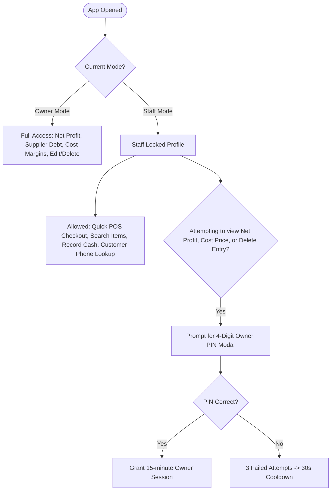

# SajiloPasal: Security & Data Integrity Specification

This document defines the mathematical accounting integrity rules, PIN protection access control, data encryption, and Supabase Row Level Security (RLS) policies for **SajiloPasal**.

---

## 1. Double-Entry Accounting Integrity Rules

1. **Immutable Ledger Append-Only Rule:**
   * Customer and Supplier debt balances are **derived mathematical sums** calculated from verified ledger transaction entries:
     $$\text{Customer Balance} = \sum \text{Debits (Udharo Issued)} - \sum \text{Credits (Settlements / Returns)}$$
   * Manual overwriting of a customer's `current_balance` without creating an explicit ledger entry is strictly forbidden.
2. **Transaction Atomicity (ACID):**
   * Completing a split sale requires an atomic local transaction wrapping:
     1. Insert record into `transactions`
     2. Insert $N$ items into `transaction_items`
     3. Decrement stock for $N$ records in `products`
     4. Insert debit record into `customer_ledger` (if udharo $> 0$)
     5. Update customer summary balance in `customers`
     6. Push mutation delta into `sync_queue`
   * If any step fails, the entire transaction is rolled back immediately.

---

## 2. Staff / Helper Mode & PIN Protection



---

## 3. Supabase Row Level Security (RLS) Policies

All PostgreSQL tables in Supabase enforce merchant isolation using Row Level Security:

```sql
-- Enable RLS on all tables
ALTER TABLE products ENABLE ROW LEVEL SECURITY;
ALTER TABLE customers ENABLE ROW LEVEL SECURITY;
ALTER TABLE transactions ENABLE ROW LEVEL SECURITY;
ALTER TABLE customer_ledger ENABLE ROW LEVEL SECURITY;
ALTER TABLE expenses ENABLE ROW LEVEL SECURITY;

-- Merchant Isolation Policy (Users only access their own store data)
CREATE POLICY "Merchant Data Isolation Policy" 
ON products 
FOR ALL 
USING (merchant_id = auth.uid())
WITH CHECK (merchant_id = auth.uid());

CREATE POLICY "Customer Ledger Isolation Policy" 
ON customer_ledger 
FOR ALL 
USING (merchant_id = auth.uid())
WITH CHECK (merchant_id = auth.uid());

CREATE POLICY "Transactions Isolation Policy" 
ON transactions 
FOR ALL 
USING (merchant_id = auth.uid())
WITH CHECK (merchant_id = auth.uid());
```
