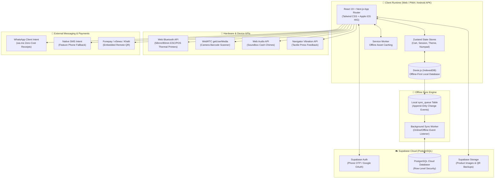
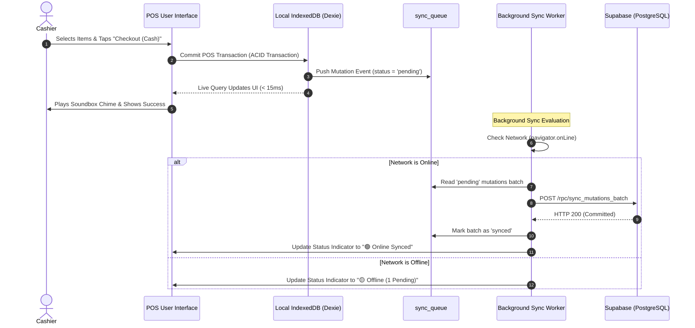

# SajiloPasal: System Architecture Specification

This document details the high-level architecture, offline-first data flow, component interactions, and state synchronization lifecycles for **SajiloPasal**.

---

## 1. High-Level Architecture Diagram



---

## 2. Offline-First Data Flow & Sync Lifecycle

### Principles:
1. **Zero-Latency Billing:** The cashier interface **never waits for a network request**. Every cart action, sale completion, expense log, and customer settlement writes synchronously to local IndexedDB.
2. **Deterministic Mutation Queue:** Every local write logs an event record in `sync_queue` with monotonic timestamps and operation types (`INSERT`, `UPDATE`, `DELETE`).
3. **Optimistic UI Updates:** The UI reflects database state instantaneously via Dexie live queries (`useLiveQuery`).



---

## 3. Conflict Resolution Strategy

1. **Transactions & Ledgers:** All financial debit/credit ledger records are **append-only**. Because records are immutable inserts rather than updates, merge conflicts are virtually eliminated.
2. **Master Entities (Products, Customers, Suppliers):** Evaluated using **Last-Write-Wins (LWW)** based on client-side UTC timestamps (`updated_at`).
3. **Inventory Count Reconciliation:** Inventory deductions on sale are computed using delta offsets (`stock_delta = -qty`) rather than absolute balance overwrites.

---

## 4. Multi-Device Responsive Layout Strategy

```
📱 MOBILE VIEW (< 768px)
- Fixed Frosted Top Bar with Search & B.S. Date
- 2-Column Product Quick Grid with Image Thumbnails
- Sticky Bottom Action Bar with Running Item Count & Total
- Slide-Up Bottom Sheet for Split Payment & Cash Chips
- Fixed Bottom Navigation Bar (POS, Khata, Supplier, Expenses, More)

💻 TABLET / DESKTOP POS (>= 768px / >= 1024px)
- Left Fixed Sidebar (220px): Category Pills, Ledgers, Reports, Settings
- Center Catalog Section (Flexible): 4-to-6 column Quick Grid, Search Bar, Kirana Unit Calculator
- Right Pinned Register (380px): Live Itemized Bill, Discount Bar, Rupee Note Chips, Split Checkout CTAs
```
