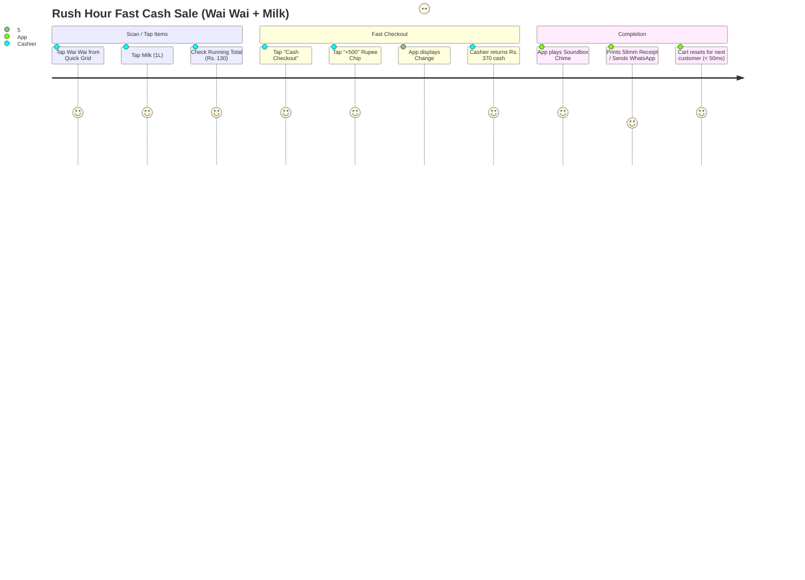
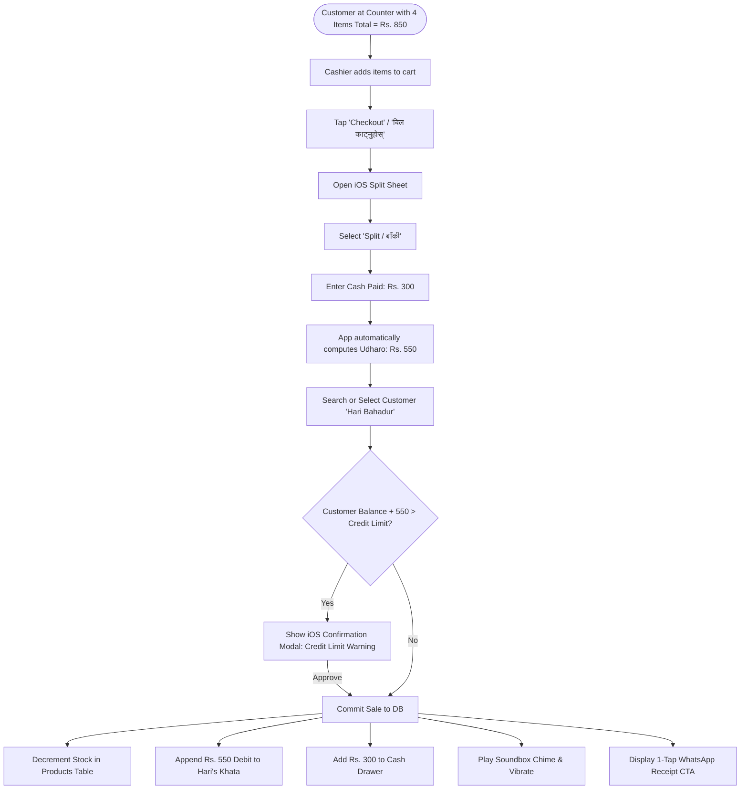
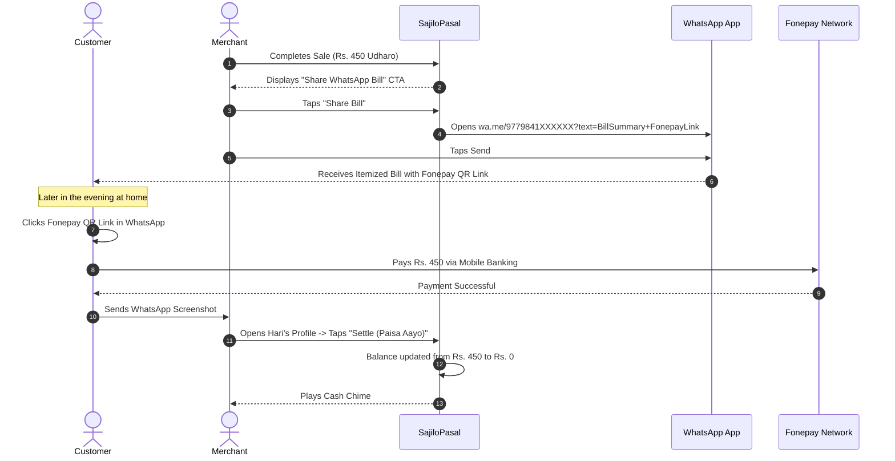
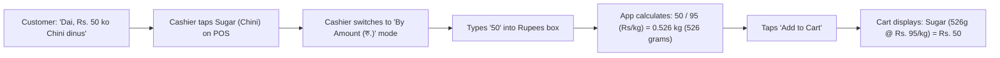

# SajiloPasal: User Journeys & Workflow Diagrams

This document illustrates the end-to-end user journeys for the primary operational scenarios of **SajiloPasal**.

---

## 1. Journey 1: Rush-Hour Quick Cash POS Checkout



---

## 2. Journey 2: Split Payment & Udharo Debt Issuance



---

## 3. Journey 3: 1-Tap WhatsApp Receipt & Remote Payment Collection



---

## 4. Journey 4: Loose Item Price-to-Weight Calculator



---

## 5. Journey 5: Daily Store Expense Logging & True Net Profit

```mermaid
flowchart TD
    OpenExpense[Cashier opens 'Expenses' Tab] --> SelectCategory[Taps 'चिया/खाजा (Tea/Snacks)']
    SelectCategory --> EnterAmt[Enters Amount: Rs. 120]
    EnterAmt --> SaveExpense[Taps 'खर्च सुरक्षित गर्नुहोस्']
    SaveExpense --> DBUpdate[Appends to expenses table]
    DBUpdate --> RecalcDashboard[Real-Time Net Profit Recalculated:]
    RecalcDashboard --> Math["Net Profit = Gross Sales (Rs. 12,500) - COGS (Rs. 8,200) - Expenses (Rs. 620) = Rs. 3,680"]
```
